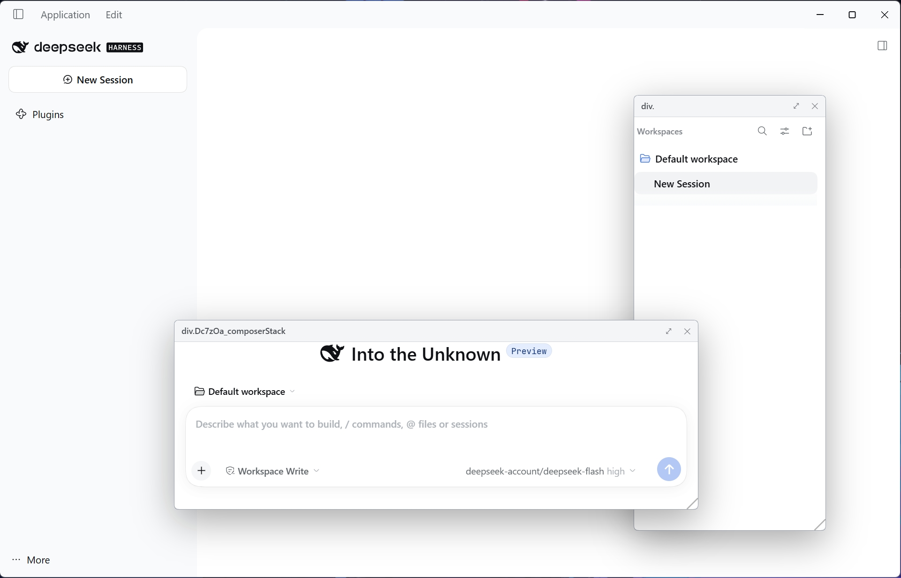
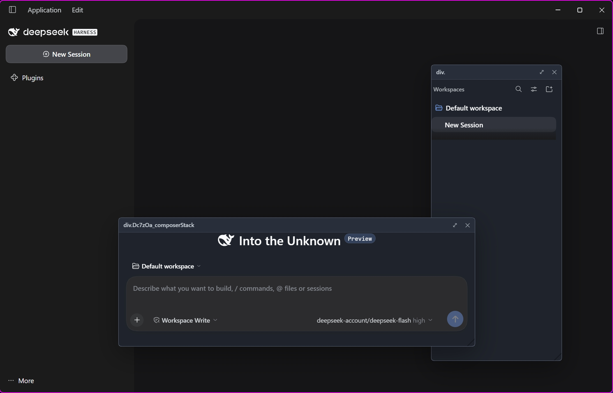

# @metaone01/dsh-better-float

Turn frequently used regions of DSH Desktop into interactive, movable in-app panels.

[中文](./README.md) · [External window extraction (Preview)](./docs/EXTERNAL-WINDOW-PREVIEW.md) · [Development](./docs/DEVELOPMENT.md) · [Changelog](./CHANGELOG.md)

## Features

- Select a region with a shortcut, then adjust the selection with the mouse wheel or arrow keys.
- Move and resize in-app panels, keep interacting, and attempt restoration when closing a panel.
- Find and reposition panels using thumbnails in the floating panel manager.
- Follow DSH's Chinese or English interface language.
- **External window extraction is a preview feature.** An optional local companion displays supported content and controls in a separate window. It needs additional configuration and has compatibility limits.

In-app panels prefer moving the original DOM nodes to preserve state and interaction. Complex editors, virtual lists, iframes, Canvas, media and Shadow DOM can still lose styles or state. Start with a region you can safely reopen.

## Installation

This is a **DSH Desktop plugin**, requiring a host with plugin management and the relevant UI services. It is not a standalone desktop app or a general browser extension. A fully verified minimum DSH version has not been established. Update the host and include its version when reporting missing services.

### Install from npm

This project distributes prebuilt npm packages. Once the maintainer has published this version, enter the following in DSH's plugin manager:

```text
@metaone01/dsh-better-float@0.1.1
```

Fully quit and restart DSH Desktop, then press `Ctrl+Shift+S` (`Cmd+Shift+S` on macOS) in a recoverable region. If another command owns the shortcut, find Better Float's selection and manager commands in DSH's shortcut settings and rebind them.

You do not need to clone the repository, install development dependencies or build the plugin. The published package runs no build on installation. DSH supplies React; do not install another copy for this plugin.

### Install a supplied package file

For testing before publication or offline installation, enter an absolute package path in a DSH plugin manager that supports local packages, for example:

```text
C:/Downloads/metaone01-dsh-better-float-0.1.1.tgz
```

This installs the plugin. The optional external window preview separately requires an Electron runtime and pairing configuration; see the [preview guide](./docs/EXTERNAL-WINDOW-PREVIEW.md). No pnpm build permission exception is required for this package.

If you previously installed the unscoped package, remove that old plugin in DSH before installing `@metaone01/dsh-better-float` to avoid duplicate shortcut registration.

### Uninstall

Close floating panels, remove `@metaone01/dsh-better-float` in DSH's plugin manager, then quit and restart Desktop. If you configured the preview manually, also remove this plugin's preview settings and stop any manually launched companion as described in the preview guide.

## First use

1. Press the selection shortcut and point to a region.
2. Adjust the scope with the wheel or `↑` / `↓`. Click, release a drag or press `Enter` to confirm. Press `Esc` to cancel.
3. Drag the title bar to move a panel; drag its lower-right corner to resize. Click to raise it.
4. Close with `✕` to attempt restoration. Restore panels before switching workspaces or closing the source page.

| Action | Windows / Linux | macOS |
| --- | --- | --- |
| Start selection; press again to cancel | `Ctrl+Shift+S` | `Cmd+Shift+S` |
| Toggle floating panel manager | `Ctrl+Alt+Shift+S` | `Cmd+Option+Shift+S` |
| Change selection level | `↑` / `↓` or wheel | Same |
| Confirm | Click, release a drag or `Enter` | Same |
| Cancel selection, manager or placement | `Esc` | Same |

These are default bindings, not a claim that every platform has passed live host acceptance.

The manager uses **two-step placement**: select a thumbnail, then click the destination for the panel's top-left corner. Press `Esc` before the second click to cancel placement.

## Screenshots

These show in-app panels, not the external window preview.

| Light theme | Dark theme |
| --- | --- |
|  |  |

## External window extraction (Preview)

**This feature is in preview. Installing the plugin does not configure a companion automatically.** The “Open external window (Preview)” button checks for a backend and requests confirmation for supported connections. Keep using the in-app panel if the backend is unconfigured, the selection is unsupported or connection fails.

The local companion displays adapted content and forwards explicitly supported operations to the source controls. It cannot reproduce arbitrary pages in another process. Limited adapters cover native buttons, text inputs, some workspace operations and DSH composer drafts. Menus, attachments and sending remain in Desktop.

A connection can transfer selected text and control values. Review your selection for private information before approving. See the [preview guide](./docs/EXTERNAL-WINDOW-PREVIEW.md) for setup, limits and shutdown instructions.

## Troubleshooting

**Git installation asks for `allowBuilds`.** Use a published npm version or a prebuilt `.tgz` instead of `github:metaone01/dsh-better-float`. Git source installation is not the recommended user distribution path.

**The shortcut does nothing.** Fully restart Desktop, check plugin enablement and shortcut conflicts, and try outside a modal dialog. Include host/plugin versions and startup errors in a report.

**External windows are unconfigured or unavailable.** This optional preview needs an Electron companion and Host pairing configuration. In-app panels work independently. Do not change global build permissions just to clear this message.

**Styles change or restoration fails.** Close the panel to attempt restoration. If the host replaced the original region, reopen it or restart Desktop. Include the selected region, theme, scale and reproduction steps, and redact screenshots.

## Feedback and development

Report issues through [GitHub Issues](https://github.com/metaone01/dsh-better-float/issues), including DSH version, plugin version, OS, reproduction steps and whether the external window preview was used. Current maintenance focuses on Windows; external windows on other systems need separate verification.

See [development instructions](./docs/DEVELOPMENT.md) for source builds, project structure and packaging. Historical diagnostics remain under `docs/history/` in the repository and are excluded from the npm package.

## License

Project code is licensed under the [MIT License](./LICENSE), copyright metaone01. Keep the copyright and permission notice when redistributing; the software is provided as is. DSH, React and the separately supplied Electron runtime retain their own licenses and are not bundled as complete runtimes in this package.
