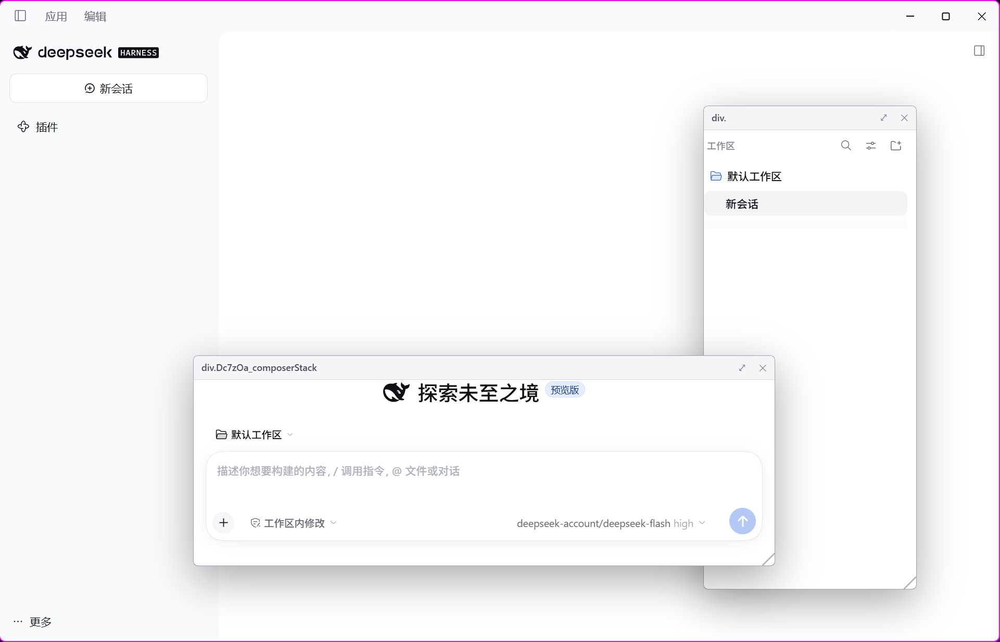
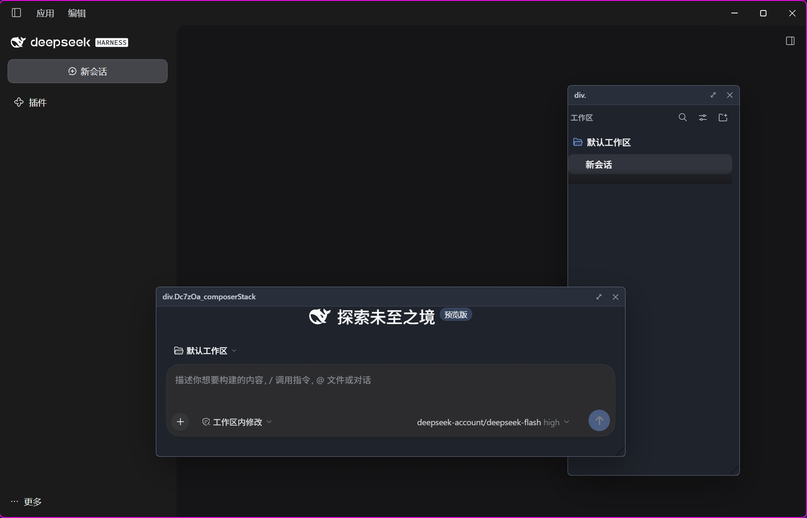

# @metaone01/dsh-better-float

把 DSH Desktop 中常用的界面区域变成可拖动、缩放的应用内浮动面板。

[English](./README.en.md) · [外部窗口提取（预览）](./docs/EXTERNAL-WINDOW-PREVIEW.md) · [开发说明](./docs/DEVELOPMENT.md) · [更新记录](./CHANGELOG.md)

## 能做什么

- 用快捷键选择界面元素，通过滚轮或方向键调整选择范围。
- 将选区放入应用内面板，移动、缩放并继续操作；关闭面板时尝试放回原布局。
- 通过浮窗管理器浏览缩略图、找回面板并重新摆放。
- 随 DSH 切换中英文界面。
- **外部窗口提取为预览功能**：可选的本机 companion 为受支持的内容和控件提供独立窗口，需要额外配置，存在兼容性限制。

应用内面板优先移动真实 DOM 节点，以保留原有状态和交互。复杂编辑器、虚拟列表、iframe、Canvas、媒体和 Shadow DOM 仍可能出现样式或状态变化；请先在可恢复的区域尝试。

## 安装

这是 **DSH Desktop 插件**，需要提供插件管理功能及相关界面服务的 DSH Desktop。它不是独立桌面应用，也不是安装到任意网页的浏览器扩展。目前没有声明经过完整验证的最低 DSH 版本；出现服务缺失时请更新宿主并提供版本信息。

### 从 npm 安装

本项目采用预构建 npm 包分发。维护者发布对应版本后，在 DSH 的插件管理入口输入：

```text
@metaone01/dsh-better-float@0.1.1
```

安装完成后完整退出并重新启动 DSH Desktop。打开一个可恢复的区域，按 `Ctrl+Shift+S`（macOS 为 `Cmd+Shift+S`）开始选择。若快捷键冲突，可在 DSH 快捷键设置中查找 Better Float 的选择和浮窗管理命令并重新绑定。

**普通用户无须克隆仓库、安装开发依赖或运行构建脚本。** 本包不在安装时执行构建；React 由 DSH 提供，不需要自行另装一份。

### 使用维护者提供的安装包

发布前测试或离线安装时，可在支持本地包的 DSH 插件管理入口输入 `.tgz` 的绝对路径，例如：

```text
C:/Downloads/metaone01-dsh-better-float-0.1.1.tgz
```

这只安装插件包；外部窗口预览所需的 Electron 运行时和配对配置见[预览功能说明](./docs/EXTERNAL-WINDOW-PREVIEW.md)。无需为此包放宽 pnpm 的构建脚本权限。

如果此前安装过旧的裸包名版本，请先在 DSH 插件管理器移除旧插件，再安装 `@metaone01/dsh-better-float`，避免重复注册相同的快捷键。

### 卸载

先关闭浮动面板，再在 DSH 插件管理器中移除 `@metaone01/dsh-better-float`，退出并重启 Desktop。若曾手动配置外部窗口预览，还需按预览说明清理该插件的配置并停止手动启动的 companion。

## 第一次使用

1. 按选择快捷键，将鼠标移到想浮动的区域上。
2. 用滚轮或 `↑` / `↓` 调整选中范围；点击、拖动后松开，或按 `Enter` 确认。按 `Esc` 取消。
3. 拖动面板标题栏移动，拖动右下角调整大小，点击面板使其置前。
4. 点击标题栏的 `✕`，尝试将真实控件恢复到原位置。建议在切换工作区或关闭原页面之前先恢复。

| 操作 | Windows / Linux | macOS |
| --- | --- | --- |
| 开始选择；再次按下取消 | `Ctrl+Shift+S` | `Cmd+Shift+S` |
| 打开／关闭浮窗管理器 | `Ctrl+Alt+Shift+S` | `Cmd+Option+Shift+S` |
| 调整选择层级 | `↑` / `↓` 或滚轮 | 同左 |
| 确认选择 | 点击、拖动后松开或 `Enter` | 同左 |
| 取消选择、管理器或放置 | `Esc` | 同左 |

快捷键表是默认绑定，不表示各平台均已完成真实宿主验收。

浮窗管理器采用**两步放置**：先点一个缩略图，再在目标位置点击一次确定面板左上角。在第二次点击之前按 `Esc` 可取消放置。

## 实际截图

以下截图展示应用内浮动面板，不代表外部窗口预览的效果。

| 亮色主题 | 暗色主题 |
| --- | --- |
|  |  |

## 外部窗口提取（预览）

**这项功能尚处于预览阶段，默认安装不会自动配置 companion。** 面板上的“外部窗口提取（预览）”按钮会检查后端，支持的路径会要求先确认连接。未配置、选区不支持或连接失败时，请继续使用应用内面板。

外部窗口通过本机 companion 展示适配后的内容，并将明确支持的操作传回源控件；它不承诺把任意网页完整搬入另一个进程。原生按钮、文本输入框、部分工作区和 DSH 聊天草稿有受限适配；菜单、附件和发送等操作仍应在 Desktop 中完成。

连接可能传输选区文字和控件值，请在确认前检查是否包含私密内容。功能范围、配置方法、退出方式和已知限制见[外部窗口预览说明](./docs/EXTERNAL-WINDOW-PREVIEW.md)。

## 常见问题

**安装提示 Git 依赖需要 `allowBuilds`？** 这是源码 Git 安装触发构建的路径。请改用 npm 版本号或维护者提供的预构建 `.tgz`，不要用 `github:metaone01/dsh-better-float` 作为普通用户安装入口。

**快捷键没有反应？** 完整重启 Desktop，检查插件是否启用、是否有快捷键冲突；先在没有模态对话框的普通页面区域尝试。仍无响应时，记录 DSH 和插件版本及启动错误。

**外部窗口提示未配置或不可用？** 这是可选预览功能，需要 Electron companion 和 Host 配对配置。普通应用内面板不依赖此功能；不要仅为了消除提示而修改全局构建权限。

**提取后样式变化或控件不能恢复？** 关闭面板尝试恢复；若源区域已被宿主替换，可能需要重新打开该区域或重启 Desktop。提交问题时说明选取的区域、主题、缩放和复现步骤，并遮盖截图中的敏感信息。

## 反馈与开发

通过 [GitHub Issues](https://github.com/metaone01/dsh-better-float/issues) 报告问题，附上 DSH 版本、插件版本、操作系统、复现步骤，以及是否使用了外部窗口预览。当前维护重点是 Windows；其他系统的外部窗口路径尚需单独验证。

源码构建、项目目录和打包方法见[开发说明](./docs/DEVELOPMENT.md)。历史调试记录保存在仓库的 `docs/history/`，不作为当前用户安装步骤，也不随 npm 包分发。

## 许可证

本项目代码采用 [MIT License](./LICENSE)，版权归 metaone01。允许使用、修改和再分发，须保留版权和许可声明；软件按原样提供。DSH、React 和单独提供的 Electron 运行时各自遵循其许可证，未作为完整运行时捆绑进本包。
